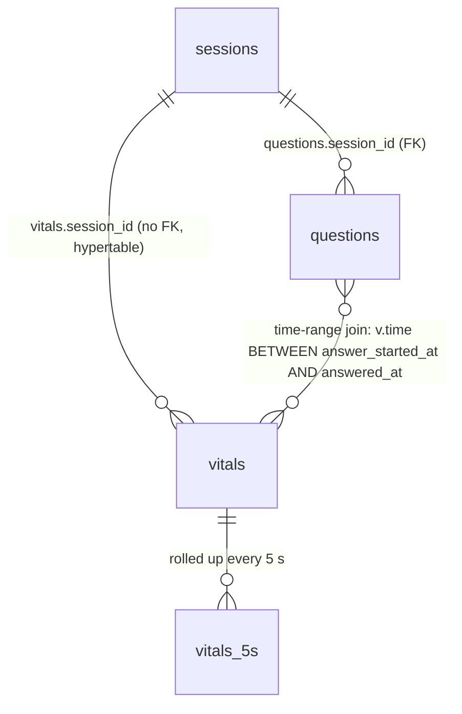

# StressTest data context

What is in our Tiger Data database, what each column means, and who touches it. Written for teammates and for their Claude sessions: paste this file into context before writing anything that reads or writes vitals.

- **Database:** Tiger Data (PostgreSQL + TimescaleDB), one cloud service. Verified on PostgreSQL 18.6 + TimescaleDB 2.30.2. Connection string in `TIGER_DATABASE_URL` (in `backend/.env`, never in git).
- **Schema file:** [`backend/data/schema.sql`](../../backend/data/schema.sql), applied by `python scripts/init_db.py`.
- **Access rule:** nobody writes SQL outside `backend/data/`. Brain and Sensing call the functions in [`backend/data/queries.py`](../../backend/data/queries.py) (signatures in [PLAN.md section 3](../PLAN.md)).
- **Time:** every timestamp is `TIMESTAMPTZ` and stored in UTC. `vitals.time` comes from the sensing client's clock (the `ts` field), and everything else comes from the database's `now()`.

## Tables at a glance

| Object | Kind | Grain (one row per…) | Rows per 5-min session | Written by | Read by |
|---|---|---|---|---|---|
| `sessions` | table | interview session | 1 | Brain via `create_session`, `end_session`, `save_report`; Data via `compute_baseline` | Data's queries, replay endpoint, Brain via `get_report` |
| `questions` | table | question asked (incl. calibration and follow-ups) | ~5 to 10 | Brain via `insert_question`, `mark_answer_started`, `mark_answered` | `get_question_stats`, `get_session_history`, replay endpoint |
| `vitals` | **hypertable** (partitioned on `time`) | vitals reading, ~1 per second | ~300 | Sensing's `POST /api/vitals` → `insert_vitals`; `compute_baseline` backfills `stress` | `get_window_stats`, `get_question_stats`, `compute_baseline`, `vitals_5s` |
| `vitals_5s` | **continuous aggregate** (real-time) | 5-second bucket × session | ~60 | TimescaleDB itself (refresh policy every 30 s) | Replay endpoint `series` |



## `sessions`

One row per interview. Holds the calm **baseline** that every stress number is relative to.

| Column | Type | Null? | Unit / values | Meaning | Written by |
|---|---|---|---|---|---|
| `id` | UUID PK | no | `gen_random_uuid()` | Session id used everywhere (WebSocket path, URLs) | `create_session` |
| `user_name` | TEXT | yes | free text | Name entered on the setup page | `create_session` |
| `interview_type` | TEXT | yes | e.g. `swe`, `behavioral`, `demo` | Chosen on the setup page | `create_session` |
| `role_title` | TEXT | yes | free text | e.g. "SWE Intern" | `create_session` |
| `started_at` | TIMESTAMPTZ | no | UTC, default `now()` | When the session row was created | default |
| `ended_at` | TIMESTAMPTZ | yes | UTC | Null while the session is live | `end_session` |
| `baseline_hr` | REAL | yes | bpm | Calm heart rate from calibration | `compute_baseline` |
| `baseline_br` | REAL | yes | breaths/min | Calm breathing rate from calibration | `compute_baseline` |
| `baseline_focus` | REAL | yes | 0.0 to 1.0 | Calm focus from calibration | `compute_baseline` |
| `baseline_n` | INT | yes | count | Readings averaged into the baseline. **0 means population defaults were used** (HR 75, BR 15, focus 0.75) because calibration had fewer than 10 good readings | `compute_baseline` |
| `report` | JSONB | yes | Brain's `Report` (brain.md) | Gemini's final report, served at `/api/sessions/{id}/report` | `save_report` |

**Active session** = most recent row with `ended_at IS NULL` and `started_at` in the last 30 minutes (`get_active_session`, cached 2 s). Sensing tags readings with it when they arrive without a `session_id`.

## `questions`

One row per question the interviewer asks, including the calibration chat (`idx = 0`).

| Column | Type | Null? | Unit / values | Meaning | Written by |
|---|---|---|---|---|---|
| `id` | UUID PK | no | | Question id (`question_id` in WS events) | `insert_question` |
| `session_id` | UUID FK → sessions.id | no | | | `insert_question` |
| `idx` | INT | no | 0 = calibration, then 1, 2, … | Order within the session | `insert_question` |
| `kind` | TEXT | no | `calibration` \| `main` \| `follow_up` | Not enforced by the DB; Brain only sends these three | `insert_question` |
| `text` | TEXT | no | | What the interviewer said | `insert_question` |
| `transcript` | TEXT | yes | | The user's answer (browser speech-to-text) | `mark_answered` |
| `created_at` | TIMESTAMPTZ | no | UTC, default `now()` | When the question was generated (before the audio played) | default |
| `answer_started_at` | TIMESTAMPTZ | yes | UTC | Frontend's `answer_started` (audio finished, mic on) | `mark_answer_started` |
| `answered_at` | TIMESTAMPTZ | yes | UTC | Frontend's `answer_done` | `mark_answered` |

**Answer window** (used by `get_question_stats` and the replay chart's shaded regions): `COALESCE(answer_started_at, created_at)` to `COALESCE(answered_at, now())`.

## `vitals` (hypertable)

One row per reading from Presage (or `mock_vitals.py`), about 1 per second while a session is active. Partitioned by `time` into 7-day chunks (TimescaleDB default). Indexes: `vitals_session_time (session_id, time DESC)`, which every query uses, plus TimescaleDB's default `vitals_time_idx (time DESC)`.

| Column | Type | Null? | Unit / range | Meaning | Notes |
|---|---|---|---|---|---|
| `time` | TIMESTAMPTZ | no | UTC | Sensing client's `ts` | Not unique: no constraint stops two rows with the same `(session_id, time)`, so the sensing client must send exactly 1/s |
| `session_id` | UUID | no | | Session the reading belongs to | No foreign key (hypertable); set from the reading or the active session |
| `heart_rate` | REAL | yes | bpm, ~40 to 180 | | Null when no face |
| `breathing_rate` | REAL | yes | breaths/min, ~6 to 40 | | Null when no face or not supported |
| `focus` | REAL | yes | 0.0 to 1.0 | Presage attention/engagement | Null when no face or not supported |
| `expression` | TEXT | yes | `neutral`, `happy`, `surprised`, `frown`, `confused`, `unknown` | Dominant facial expression | Enum enforced by Pydantic (`Expression`), not the DB |
| `confidence` | REAL | yes* | 0.0 to 1.0 | Face / signal quality | *Always set in practice (contract default 1.0). **Rows with `confidence < 0.5` are excluded from every average and get `stress = NULL`** |
| `stress` | REAL | yes | 0 to 100 | Computed on insert by `metrics.stress_score` | NULL when: no baseline yet (calibration), `confidence < 0.5`, or all of HR/BR/focus missing. `compute_baseline` backfills calibration rows |

### Stress score

Computed in Python (`backend/data/metrics.py`), stored per row, never recomputed in SQL:

```
hr_part    = clamp((hr / baseline_hr - 1) * 100 / 25, 0, 1)      # +25% HR = max
br_part    = clamp((br / baseline_br - 1) * 100 / 40, 0, 1)      # +40% breathing = max
focus_part = clamp((baseline_focus - focus) / 0.5, 0, 1)         # 0.5 focus drop = max
stress     = 100 * (0.5*hr_part + 0.3*br_part + 0.2*focus_part)  # missing inputs drop out, weights renormalize
```

Thresholds (fixed, everyone uses them): **< 40 calm · 40 to 70 rising · > 70 high**.

## `vitals_5s` (continuous aggregate)

5-second rollups for the replay chart. `materialized_only = false`, so queries also include rows newer than the last refresh (real-time aggregate). Refresh policy: every 30 s, window from 1 hour ago to 5 s ago. TimescaleDB indexes the materialized data on `(session_id, bucket DESC)` automatically, so a per-session replay read is an index scan.

| Column | Type | Meaning |
|---|---|---|
| `bucket` | TIMESTAMPTZ | Start of the 5-second bucket (`time_bucket('5 seconds', time)`) |
| `session_id` | UUID | |
| `hr` | double | `avg(heart_rate)`. **Includes low-confidence rows** (the view has no confidence filter), but those rows have null vitals, so `avg` skips them |
| `br` | double | `avg(breathing_rate)` |
| `focus` | double | `avg(focus)` |
| `stress` | double | `avg(stress)` (nulls skipped) |
| `stress_peak` | REAL | `max(stress)` in the bucket |

A bucket where the face was lost for the whole 5 s has all-null values: the chart should show a gap, not a zero.

## Gotchas

1. **Stress is null before the baseline exists.** The first ~40 s of every session (calibration) have `stress = NULL` until Brain calls `compute_baseline`, which then backfills them. If the chart starts empty, `compute_baseline` wasn't called.
2. **`confidence < 0.5` rows are stored but ignored.** They keep the 1 Hz stream continuous (so gaps are visible) but never enter averages.
3. **`get_window_stats` uses the database clock** (`now()`), while `vitals.time` comes from the laptop. Clock skew of a few seconds just shifts the window.
4. **Backfilled stress reaches `vitals_5s` on the next refresh** (≤ 30 s). The replay is fetched after the session, so this never shows.
5. **Deltas are percentages**, not fractions: `hr_delta_pct = 22.0` means 22% above baseline.

## Function → table map

| Function (`queries.py`) | Reads | Writes | Caller |
|---|---|---|---|
| `create_session` | | `sessions` | Brain (`POST /api/sessions`) |
| `get_active_session` | `sessions` | | Sensing client, `insert_vitals`, `GET /api/sessions/active` |
| `end_session` | | `sessions.ended_at` | Brain |
| `insert_vitals` | (baseline cache) | `vitals` | Sensing (`POST /api/vitals`) |
| `compute_baseline` | `vitals`, `sessions` | `sessions.baseline_*`, `vitals.stress` (backfill) | Brain, after calibration |
| `get_baseline` | `sessions` | | Brain, Data internals |
| `get_window_stats` | `vitals` | | Brain watcher every 3 s, `decide_next` |
| `insert_question` / `mark_answer_started` / `mark_answered` | | `questions` | Brain |
| `get_question_stats` | `questions` ⋈ `vitals` (time-range join) | | Brain after every answer |
| `get_session_history` | `questions` ⋈ `vitals` | | Brain, for the final report |
| `save_report` / `get_report` | `sessions.report` | `sessions.report` | Brain |
| replay endpoint | `sessions`, `vitals_5s`, `questions` ⋈ `vitals` | | Frontend replay page |
