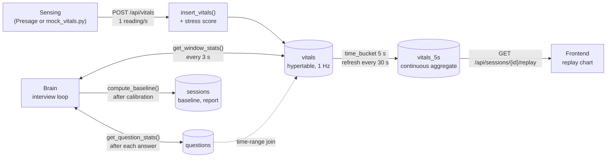
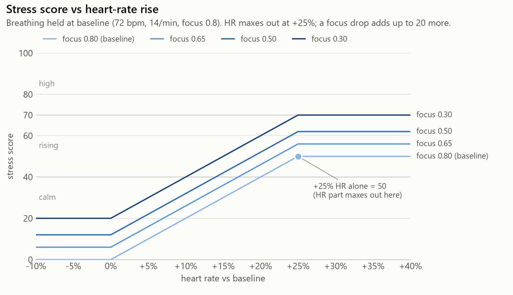
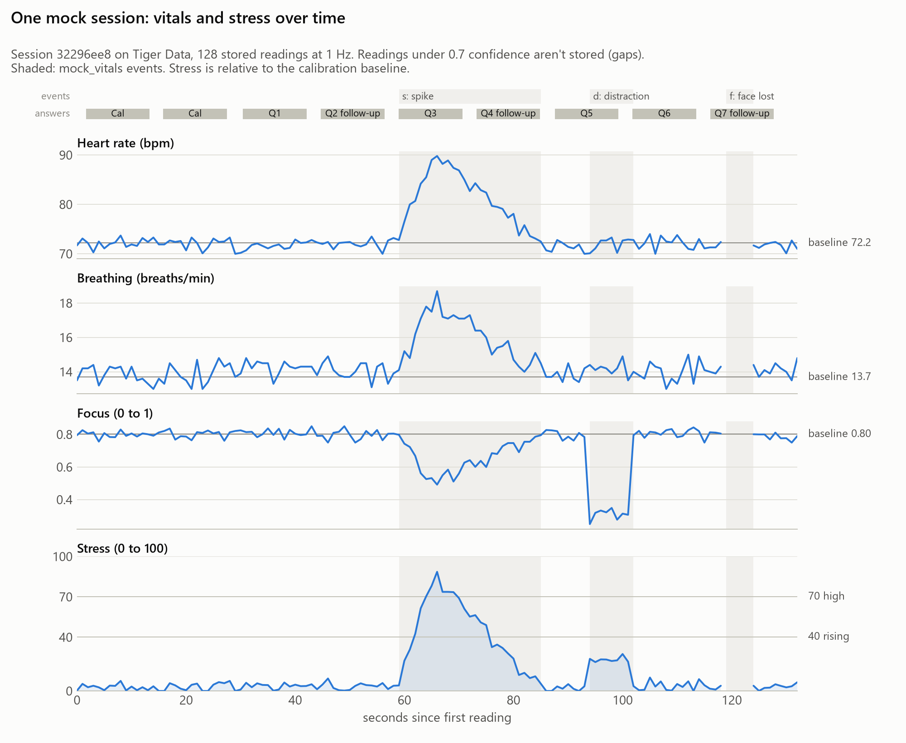
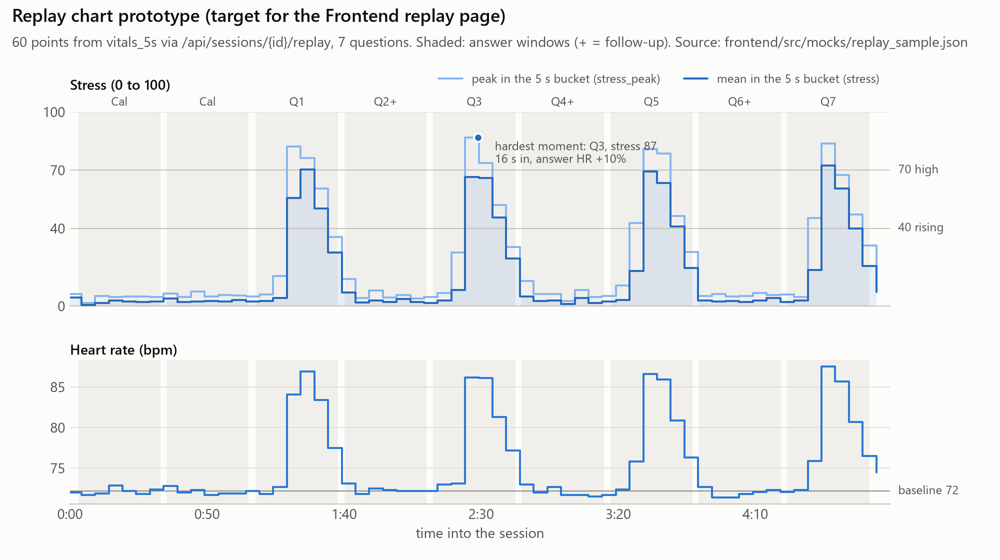
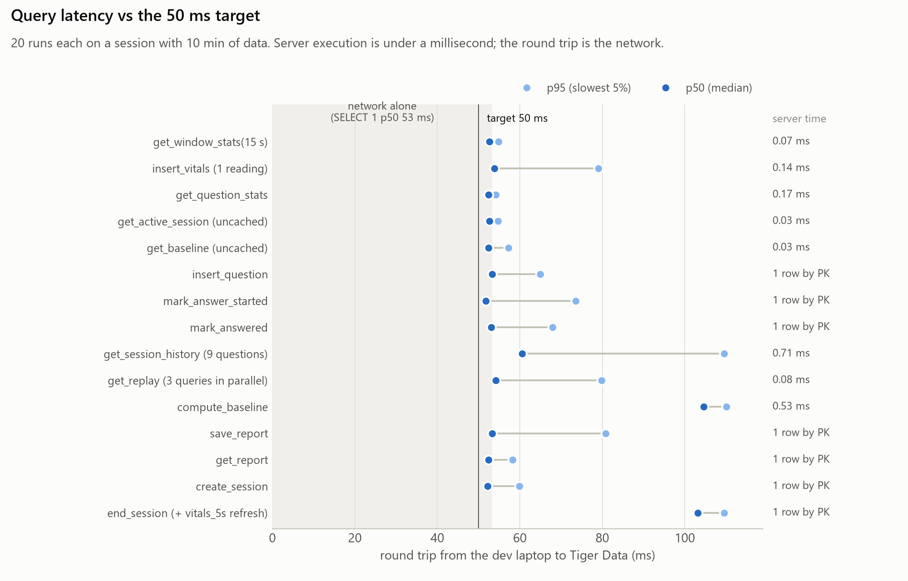
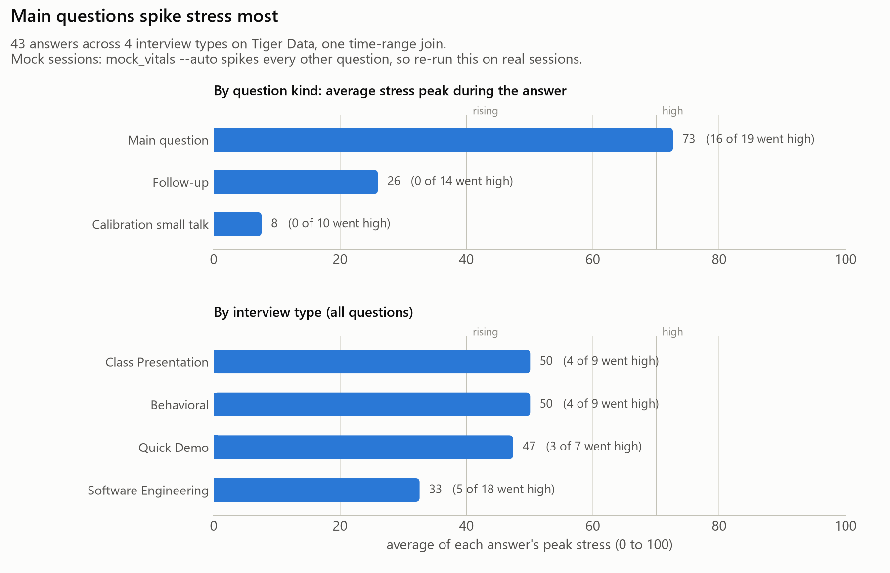

# Data: how StressTest stores, scores and replays vitals

**Owner:** Likhil. Code in [`backend/data/`](../../backend/data/), tools in [`scripts/`](../../scripts/).
Everything here runs on **Tiger Data** (Postgres + TimescaleDB). Nobody outside `backend/data/` writes SQL:
Brain and Sensing call the functions in [`queries.py`](../../backend/data/queries.py) (signatures fixed by [PLAN.md §3](../PLAN.md)).

## How data flows



1. Sensing posts one reading per second. `insert_vitals` scores it against the person's calm **baseline** and stores it in `vitals`.
2. Brain asks "how are they right now?" every 3 s (`get_window_stats`, last 10 to 15 s) and "how did they react to that question?" after each answer (`get_question_stats`, the join between a question's answer window and the vitals in it).
3. TimescaleDB rolls `vitals` into 5-second buckets (`vitals_5s`). The replay page reads those.

## Schema in one minute

| Table | One row per | What matters |
|---|---|---|
| `sessions` | interview | `baseline_hr/br/focus` (the calm reference), `report` (Gemini's JSON) |
| `questions` | question asked | `answer_started_at` → `answered_at` is the answer window |
| `vitals` | reading (~1/s) | hypertable on `time`, indexed on `(session_id, time DESC)`; `stress` is computed on insert |
| `vitals_5s` | 5 s × session | continuous aggregate (`avg` HR/BR/focus/stress, `max` stress), real-time |

Every column, unit and gotcha: **[DATA_CONTEXT.md](DATA_CONTEXT.md)**. SQL and query plans: **[queries.md](queries.md)**.

## The stress score

Stress is 0 to 100 and always **relative to your own calm baseline**, measured during the 30 to 45 s calibration chat (first 10 s skipped for Presage warm-up). Heart rate counts for half: +25% over baseline maxes its part out. Breathing counts 30% (maxed at +40%), and a focus drop of 0.5 counts 20%. If a signal is missing, the others are re-weighted, and readings with face confidence under 0.7 aren't stored or scored at all (a lost face shows as a gap). So **+25% heart rate alone = 50**, and a full mock spike (HR +25%, breathing +30%, focus 0.5) peaks around **85**. Everyone uses the same thresholds: **under 40 calm, 40 to 70 rising, over 70 high**.



## What it looks like

A mock session through Brain's real interview loop, stored on Tiger Data. The `s` key spike takes stress from 3 to 88 in six seconds, the `d` distraction raises it to about 24 (focus only), and `f` (face lost) leaves a gap, since readings under 0.7 confidence aren't stored:



The replay page's target, drawn from the real `/replay` JSON ([`frontend/src/mocks/replay_sample.json`](../../frontend/src/mocks/replay_sample.json)):



## Run it

```bash
python -m pip install -r backend/requirements.txt -r requirements-dev.txt
# TIGER_DATABASE_URL=postgres://... goes in backend/.env (gitignored)

python scripts/init_db.py              # create tables, hypertable, continuous aggregate (safe to re-run)
python scripts/init_db.py --check      # verify only
python scripts/init_db.py --reset      # drop everything and recreate (asks you to type RESET)

uvicorn backend.main:app --reload      # Data's routes and the DB pool load automatically
```

**`scripts/mock_vitals.py`**, fake Presage, posts one reading per second to `POST /api/vitals` (no session id, so it lands in the active session):

| Key | What happens |
|---|---|
| `s` | stress spike: HR ramps to +25% over 6 s, breathing +30%, focus 0.5, frown; decays over 20 s |
| `d` | distraction: focus 0.3 for 8 s, HR unchanged |
| `f` | face lost: 5 s of nulls, confidence 0 (not stored; shows as a gap) |
| `q` | quit |

| Flag | Use |
|---|---|
| `--auto` | spike ~10 s into every other question (Q1, Q3...) by polling `/api/sessions/active` + Brain's `/status` |
| `--events "60:s,95:d,120:f"` | fire events at fixed seconds (no keyboard needed) |
| `--duration 180` | stop after 180 s |
| `--url http://host:8000` | backend (default `http://localhost:8000`) |
| `--stdout` | print NDJSON instead of posting (no backend needed); `--fast` makes it instant |
| `--seed 7`, `--events-out events.csv` | reproducible noise; log when each event fired |

Other tools: `python scripts/export_session.py latest --name mysession` (CSV export to `docs/data/samples/`),
`python -m pytest backend/data/tests` (Data's tests; the real-DB ones skip without a URL).
Set **`DATA_FAKE=1`** to run the whole backend without a database (in memory, nothing saved). Pytest does this automatically.

## Queries and how fast they are

Server execution is what the database spends; round trip is what the caller waits from the dev laptop. Every round trip sits on the **53 ms network floor** (a bare `SELECT 1`), so we treat the 50 ms target as the database budget ([latency.md](latency.md)).

| Function | Purpose | Server | Round trip p50 |
|---|---|---|---|
| `insert_vitals` | store a reading + its stress (Sensing, 1/s) | 0.14 ms | 54 ms |
| `get_window_stats` | "how are they right now" (Brain watcher, every 3 s) | 0.07 ms | 53 ms |
| `get_question_stats` | "how did they react to this question" (Brain, after each answer) | 0.17 ms | 52 ms |
| `get_session_history` | every question + stats, for Gemini's report | 0.71 ms | 60 ms |
| `compute_baseline` | calm baseline after calibration + backfill stress | 0.53 ms | 105 ms |
| `get_active_session` | which session readings belong to (cached 2 s) | 0.03 ms | 53 ms |
| `replay endpoint` | the replay page's whole payload | 0.08 ms | 54 ms |

Session and question bookkeeping (`create_session`, `insert_question`, `mark_*`, `save_report`, ...) are single-row primary-key writes at the same round trip.



## Tiger Data extras (Phase 7)

- **Columnstore:** `vitals` is set to store closed chunks column by column, one segment per session ([`backend/data/columnstore.sql`](../../backend/data/columnstore.sql), applied with `python scripts/init_db.py --columnstore`). A policy converts chunks once they're a day old, so the live chunk is never touched mid-event. Measured on a copy: **2.8x smaller** on our 5 sessions, **9.2x** at 35 ten-minute sessions, with identical query results ([compression.md](compression.md)).
- **"Which question type spikes stress most":** `queries.get_stress_by_question_type()` runs the questions ↔ vitals time-range join over every answered question in 0.5 ms. On mock data, main questions peak at 73 and follow-ups at 26, but that's how `--auto` spikes, so re-run `python scripts/viz/chart_question_types.py` after real sessions.



**Dashboard:** [dashboard.html](dashboard.html) puts the session timeline, per-question stats, latency, compression and the question-type finding on one self-contained page (open it in a browser; rebuild with `python scripts/viz/build_dashboard.py`).
**Devpost draft:** [devpost_tiger_data.md](devpost_tiger_data.md).

## Reports and charts

| File | What it shows |
|---|---|
| [DATA_CONTEXT.md](DATA_CONTEXT.md) | every table and column, units, nullability, who reads/writes |
| [queries.md](queries.md) · [latency.md](latency.md) | SQL review with plans · measured latency |
| [qa_checkpoint_phase4.md](qa_checkpoint_phase4.md) | data QA: calm ≈ 0, spikes, face-lost nulls, baseline, no duplicates, `vitals_5s` = raw rollup |
| [stats_checkpoint_phase4.md](stats_checkpoint_phase4.md) | how well stress separates calm from spikes; constants recommendation |
| [profile_mock_stream.md](profile_mock_stream.md) · [profile_checkpoint_phase4.md](profile_checkpoint_phase4.md) | ranges, nulls, confidence, 1 Hz gaps |
| [qa_replay_sample.md](qa_replay_sample.md) | QA of the replay sample session, including the replay JSON shape agreed with Frontend |
| [compression.md](compression.md) | columnstore size before/after |
| [charts/](charts/) | every chart; regenerate with the scripts in [`scripts/viz/`](../../scripts/viz/) |
